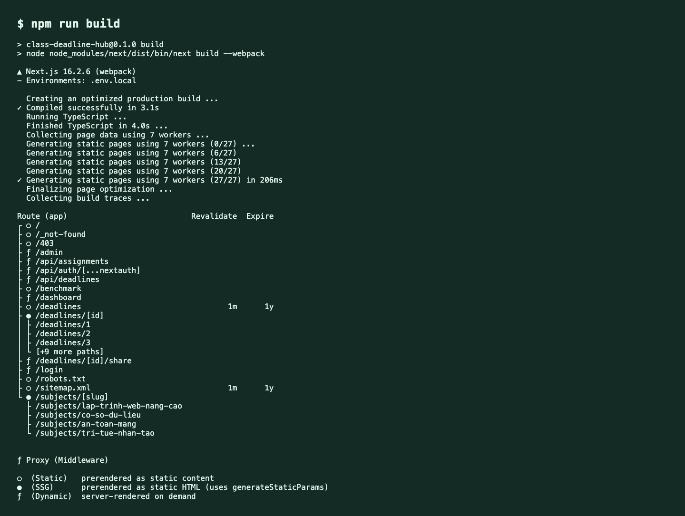
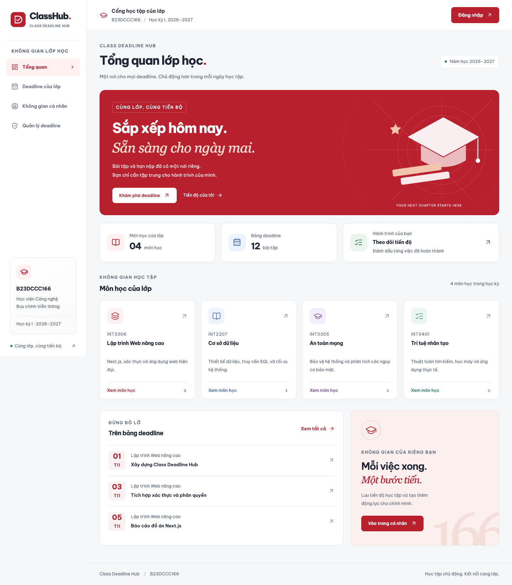
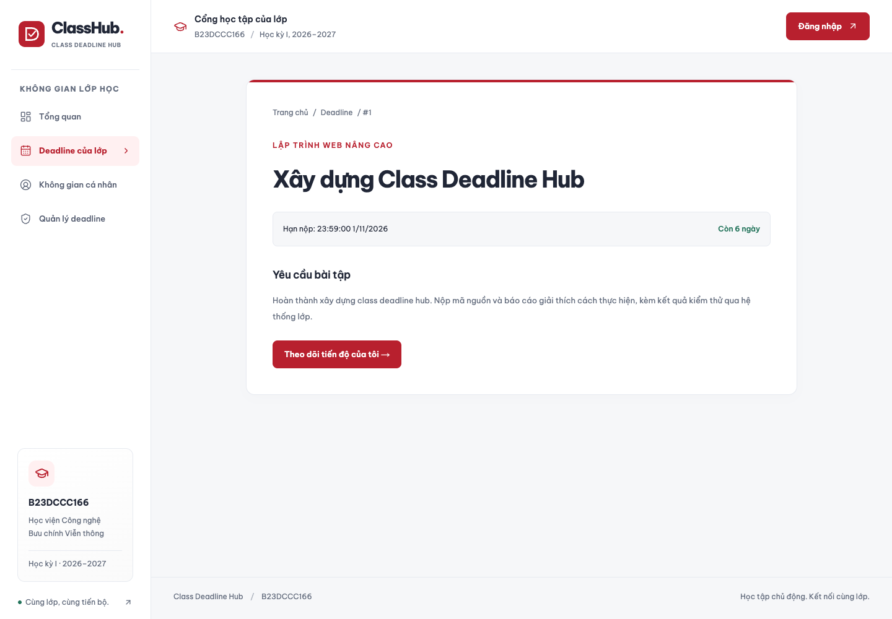
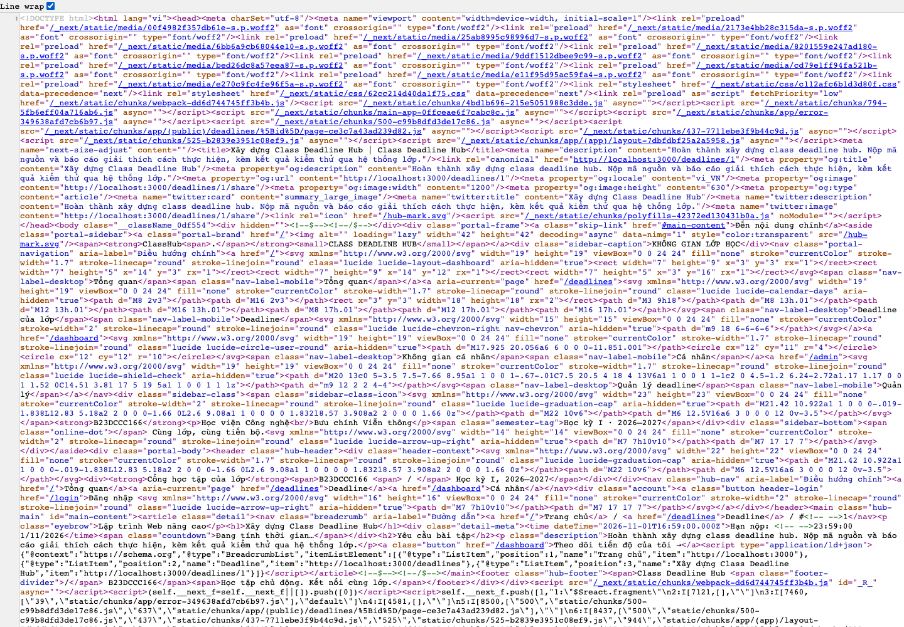

# Class Deadline Hub — Bài thực hành 3

Cổng deadline lớp B23DCCC166, triển khai bằng Next.js 16 App Router, TypeScript và Auth.js v5. Khách xem công khai; sinh viên lưu tiến độ theo tài khoản; lớp trưởng thêm/xoá deadline. Dữ liệu mẫu có 4 môn học và 12 deadline trong `data/deadlines.json`.

## Cách chạy

Cần Node.js >= 22.13 và npm. Tại thư mục dự án:

```sh
npm ci
cp .env.example .env.local
openssl rand -base64 32
```

Điền chuỗi vừa tạo vào `AUTH_SECRET` trong `.env.local`. Đặt `AUTH_URL` và `NEXT_PUBLIC_SITE_URL` là `http://localhost:3000` khi chạy local, hoặc URL website thực tế khi triển khai. Không commit `.env.local`.

```sh
npm run dev
# http://localhost:3000
```

Kiểm tra production:

```sh
npm run build
npm start
```

`next/font` tải Be Vietnam Pro lúc build, cần kết nối Google Fonts. Font được Next.js tự host sau khi build, trình duyệt không gọi Google Fonts. Các script chính đã chuyển từ Vinext sang Next.js để thực hiện đúng SSG/ISR/SSR. Mã bài Redux cũ còn ở `features/`, `components/deadlines/`, `/benchmark` và API giả lập `/api/assignments`; không dùng cho dữ liệu Hub.

| Tài khoản | Mật khẩu thực hành | Vai trò |
| --- | --- | --- |
| admin@ptit.edu.vn | admin123 | admin |
| sv@ptit.edu.vn | sv123456 | user |

Mật khẩu được lưu dạng scrypt có salt trong `data/users.json`. Không nhập khoá bí mật vào mã nguồn. Các tài khoản trên là tài khoản mẫu theo đề.

## Chiến lược render

| Route | Chiến lược | Cách triển khai và lý do |
| --- | --- | --- |
| `/` | SSG | `dynamic = 'force-static'`; giới thiệu lớp, thống kê và trích lịch môn học được chụp tại thời điểm build; tạo sẵn HTML cho trang tổng quan. |
| `/subjects/[slug]` | SSG | `generateStaticParams()` tạo 4 môn học; `dynamicParams = false`; thông tin và danh sách ban đầu là ảnh chụp tại thời điểm build. Xem `/deadlines` để có dữ liệu mới nhất. |
| `/deadlines` | ISR 60 giây | `revalidate = 60`; HTML công khai có nội dung, tái tạo ở nền sau khi hết hạn và có request. Admin thao tác còn chủ động vô hiệu cache. |
| `/deadlines/[id]` | ISR theo yêu cầu | Sinh trước 12 trang bằng `generateStaticParams`, `revalidate = false`, `dynamicParams = true`. Server Action gọi `revalidatePath` sau thêm/xoá; ID mới được tạo khi truy cập, ID đã xoá trả 404. |
| `/dashboard` | SSR | `dynamic = 'force-dynamic'`; đọc phiên và tiến độ đúng userId ở mỗi request. |
| `/admin` | SSR | `dynamic = 'force-dynamic'`; kiểm tra quyền server rồi mới đọc danh sách quản trị. |

Trang chủ và chi tiết là Server Component, HTML chứa sẵn nội dung. Chỉ các phần điều hướng theo URL, thông tin phiên ở header, bộ lọc, đếm ngược và form đăng nhập là Client Component. Form quản trị/tiến độ dùng HTML phía server. Header đọc phiên qua API Auth.js phía client để các trang công khai không bị chuyển thành SSR vì đọc cookies trong layout.

Ảnh kết quả `npm run build` (trình bày lại nguyên văn log build):



Log gốc: [build.log](docs/bth3/build.log). Ký hiệu `○` là static, `●` là static với generateStaticParams, `ƒ` là dynamic. Chi tiết mang ký hiệu `●` vì prerender lúc build; ISR theo yêu cầu được thực hiện bằng Server Actions, không có chu kỳ thời gian.

## Routing và giao diện

- `(public)` có header và footer; `(app)` có layout riêng cho không gian đăng nhập và metadata noindex.
- `/dashboard/layout.tsx` thêm sidebar lồng nhau. `usePathname()` tô sáng menu hiện tại.
- `(app)/loading.tsx` hiển thị trạng thái tải. Không đặt loading boundary ở root để ID không tồn tại trả HTTP 404 trước khi streaming HTML.
- `app/error.tsx` có nút “Thử lại”; `app/not-found.tsx` là trang 404 chung.
- `/403` giải thích thiếu quyền. `/login` giữ callbackUrl nội bộ, ngăn chuyển hướng sang website bên ngoài.

## Xác thực và phân quyền

Auth.js Credentials dùng JWT trong cookie HttpOnly; callbacks bổ sung id/role vào JWT và session. Kiểu `Role` là union `'guest' | 'user' | 'admin'`, không dùng role kiểu string chung. Khai báo mở rộng Session/User và JWT tại `types/next-auth.d.ts` (JWT v5 được định nghĩa tại `@auth/core/jwt`).

Ma trận duy nhất tại `lib/permissions.ts`:

| Hành động | guest | user | admin |
| --- | --- | --- | --- |
| Xem deadline | ✓ | ✓ | ✓ |
| Đánh dấu đã xong | ✗ | ✓ | ✓ |
| Thêm deadline | ✗ | ✗ | ✓ |
| Xoá deadline | ✗ | ✗ | ✓ |

Ba lớp bảo vệ:

1. `proxy.ts` bảo vệ `/dashboard/:path*`, `/admin/:path*`, giữ callbackUrl, user vào admin chuyển `/403`. Next.js 16 đổi tên Middleware thành Proxy; không tạo cả `middleware.ts` và `proxy.ts` cùng lúc.
2. Mỗi trang riêng tư tự gọi `requirePermission()` trước khi đọc dữ liệu.
3. Route Handler POST `/api/deadlines` kiểm tra Origin và gọi các Server Action qua phía server, rồi trả chuyển hướng 303 để trình duyệt nhận HTML mới. Cách submit này tránh lỗi React Flight transition treo pending khi revalidate ở production ([báo cáo trên Next.js](https://github.com/vercel/next.js/issues/97990)). Mỗi Server Action gọi lại `requirePermission()`, xác thực dữ liệu với Zod và chỉ lấy userId từ phiên. Tiến độ được lưu theo userId, không nhận userId do client gửi.

Các thao tác ghi được tuần tự hoá trong một Node process và dùng file tạm + rename nguyên tử để tránh ghi JSON dở dang. ID tăng đơn điệu, không tái sử dụng ID đã xoá. Xoá deadline cũng xoá tham chiếu trong tiến độ. Mô hình file JSON phù hợp chạy một Node server với ổ đĩa có quyền ghi; chưa hỗ trợ nhiều process ghi đồng thời. Vercel không có ổ đĩa ứng dụng ghi bền vững: cần đổi sang database/object storage trước khi triển khai thực tế. Bài này chưa triển khai Vercel hay GitHub OAuth; có Jest cho `can()` là mục điểm cộng.

## SEO và tối ưu

- Metadata động ở trang chi tiết: title, description, canonical, Open Graph và Twitter.
- `/deadlines/[id]/share` tạo PNG 1200×630 riêng theo tên bài, môn học và hạn nộp bằng `ImageResponse`. Metadata trỏ trực tiếp route này.
- `/sitemap.xml` gồm trang chủ, danh sách, 4 môn học và mọi deadline hiện tại; được vô hiệu cache khi thêm/xoá.
- `/robots.txt` chặn dashboard/admin/login/API/benchmark. Login và layout riêng tư còn đặt noindex.
- JSON-LD `BreadcrumbList` được render trong HTML chi tiết, escape `<` khi nhúng JSON.
- `next/font` Be Vietnam Pro hỗ trợ tiếng Việt; `next/image` có kích thước cố định cho logo và ảnh lịch trang chủ.

Ảnh trang chủ và trang chi tiết:




Ảnh view-source `/deadlines/1` và HTML gốc:



[HTML phản hồi từ server](docs/bth3/deadline-1-source.html). Có thể tự kiểm tra bằng `view-source:http://localhost:3000/deadlines/1`, tìm title, `og:image`, `BreadcrumbList` và tên bài tập.

## Lighthouse production

| Route | Performance | Accessibility | Best Practices | SEO |
| --- | --- | --- | --- | --- |
| `/` | 92 | 100 | 100 | 100 |
| `/deadlines/1` | 95 | 100 | 100 | 100 |


Đo bằng Lighthouse mobile, mô phỏng mạng/CPU mặc định trên Chrome headless ở localhost sau `npm run build` và `npm start`. Điểm có thể thay đổi theo máy và lần chạy; không phải số liệu Core Web Vitals từ người dùng thực tế.

Báo cáo đầy đủ: [Trang chủ](docs/bth3/lighthouse-home.html), [Chi tiết](docs/bth3/lighthouse-detail.html). JSON và thời điểm đo nằm trong `docs/bth3/lighthouse-summary.json`.

## Kiểm thử

```sh
npm run lint
npm test
npm run build
npm start
# Ở terminal khác, cần Google Chrome cài trên macOS:
node scripts/verify-bth3.mjs
node scripts/lighthouse-bth3.mjs
```

Jest: 28 test đạt, bao gồm 4 test duyệt đủ 12 ô trong ma trận `can()` và bộ kiểm thử bài trước. Script Playwright kiểm tra HTML/SEO/ảnh chia sẻ, callback đăng nhập, 404, sai mật khẩu, user bị chặn admin, lưu/hoàn tác tiến độ, admin thêm/xoá và vô hiệu cache chi tiết, sitemap, bộ lọc và giao diện mobile. Script có ghi dữ liệu tạm qua giao diện, rồi xoá deadline kiểm thử và hoàn tác tiến độ; chạy trên bộ dữ liệu thực hành.

## Trả lời câu hỏi

**(1) Vì sao `/deadlines/[id]` dùng ISR?**

Nội dung công khai cần HTML có sẵn để SEO, chia sẻ link và tải nhanh. Deadline thay đổi khi admin thêm/xoá, nên SSG thuần sẽ buộc build lại mới cập nhật; SSR cho mọi lượt xem sẽ tốn xử lý không cần thiết. ISR giữ lợi ích trang tĩnh, còn `revalidatePath('/deadlines/' + id)` vô hiệu cache sau khi ghi thành công. Request tiếp theo tạo nội dung mới hoặc 404 mà không phải build lại toàn bộ website. `dynamicParams = true` cho phép sinh trang cho ID mới chưa có lúc build.

**(2) Nếu chỉ dùng Middleware để bảo vệ `/admin` thì có rủi ro gì?**

Matcher có thể cấu hình thiếu, lớp chặn có thể có lỗ hổng hoặc người dùng gọi trực tiếp Server Action mà không mở trang admin. Ẩn nút trên giao diện cũng không ngăn được request tự tạo. Vì vậy trang admin phải kiểm tra phiên/quyền trước khi đọc dữ liệu; từng action phải kiểm tra lại quyền, validate đầu vào và chỉ sử dụng userId từ phiên ở phía server. Proxy là lớp chặn sớm, không thay thế kiểm tra tại nơi đọc/ghi dữ liệu.

## Tài liệu tham khảo

- [Next.js ISR](https://nextjs.org/docs/app/guides/incremental-static-regeneration)
- [Next.js Proxy](https://nextjs.org/docs/app/getting-started/proxy)
- [Auth.js Credentials](https://authjs.dev/getting-started/providers/credentials)
- Đề: LTWNC BTTH 3 Xây dựng Class Deadline Hub; slide Buổi 7 và Buổi 8 do người học cung cấp.

Khi nộp mã nguồn, bỏ `node_modules`, `.next`, `.env.local`, `coverage` và `.git`; giữ `package-lock.json`, `.env.example`, `data`, `README.md` và `docs/bth3`.


## Giao diện tham khảo PTIT S-Link

Giao diện dùng đỏ–trắng, nền xám nhẹ, sidebar điều hướng và các vùng thông tin theo phong cách cổng sinh viên. Banner có minh hoạ học thuật riêng, trang tổng quan hiển thị môn học/deadline từ dữ liệu thật tại thời điểm build. Header, danh sách deadline, đăng nhập, dashboard và form quản trị cùng một hệ màu và typography. Dashboard hiển thị phần trăm hoàn thành thật của tài khoản.

Màn hình mobile có menu rút gọn, danh sách một cột và trường nhập hỗ trợ bàn phím; không thay đổi xác thực/phân quyền hoặc chiến lược render. Các quyết định thiết kế ở [design.md](design.md). Ảnh kiểm tra desktop/tablet/mobile tại [docs/ui](docs/ui). Giao diện tham khảo [PTIT S-Link](https://slink.ptit.edu.vn/), dùng tên và biểu tượng ClassHub riêng.
